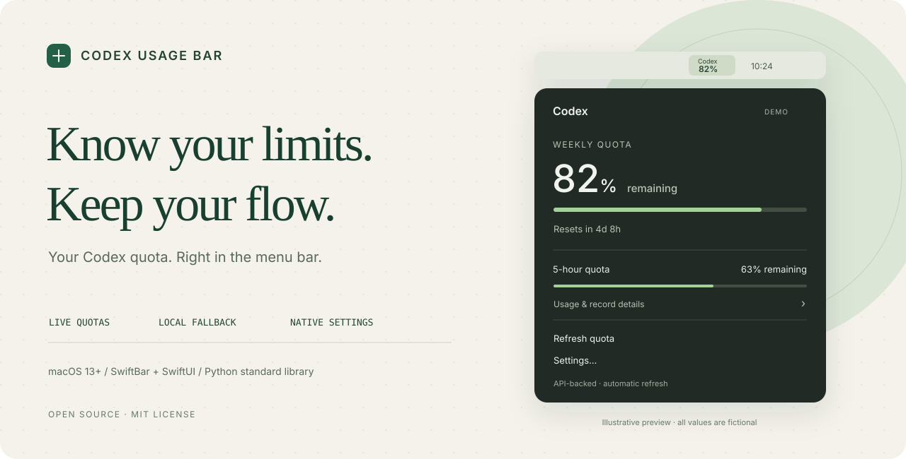

<p align="center">
  
</p>

<h1 align="center">Codex Usage Bar</h1>
<p align="center"><strong>额度，一眼掌握。专注，继续保持。</strong></p>
<p align="center">一个轻巧的 macOS 菜单栏工具：主动查询 Codex 额度，显示重置倒计时，随手调整原生设置。</p>

<p align="center">
  <a href="https://github.com/ZhengYitong2333/codex-usage-bar/actions/workflows/checks.yml"></a>
  
  
  <a href="LICENSE"></a>
</p>

<p align="center">
  <a href="#快速开始">快速开始</a> ·
  <a href="#它能做什么">功能</a> ·
  <a href="#数据从哪里来">数据来源</a> ·
  <a href="#隐私与安全">隐私</a> ·
  <a href="#开发与检查">开发</a>
</p>

## 它能做什么

| 你关心的事 | 菜单栏里的答案 |
| --- | --- |
| 还剩多少额度？ | 剩余或已用百分比，配合细进度条。 |
| 什么时候恢复？ | 重置倒计时；详情里保留准确日期。 |
| 数据够新吗？ | 明确区分接口查询、额度记录和本机扫描时间。 |
| 网络临时不通？ | 回退到本机日志，并明确显示查询失败。 |
| 没有 5 小时窗口？ | 显示“未提供”，不补造数据、不拼接旧快照。 |
| 想调得顺手？ | 原生 SwiftUI 设置，调整刷新周期、显示窗口、字号和提醒。 |
| 还用 OpenCode？ | Codex 卡片下方堆叠 OpenCode 卡片，展示 Go 的滚动/每周/每月额度与近 7 日统计。 |

菜单栏采用两行紧凑图形：上方 `Codex`，下方为当前窗口的百分比；悬停可查看窗口说明。窗口不可用时自动切换到另一个有数据的窗口。点开后是原生毛玻璃弹层，进度条以灰色渐变呈现，并在打开时播放增长动画。

## 快速开始

需要 **macOS 13+**、已登录 ChatGPT 账号的 [Codex CLI](https://learn.chatgpt.com/docs/cli)，以及 Xcode Command Line Tools 提供的 `swiftc` 和 `/usr/bin/python3`。不再依赖 SwiftBar。OpenCode 支持是可选的：安装 [OpenCode CLI](https://opencode.ai) 后会自动显示；Go/Console 额度还需要在 OpenCode 中登录。

```bash
xcode-select --install

git clone https://github.com/ZhengYitong2333/codex-usage-bar.git
cd codex-usage-bar
./install.sh
```

安装脚本会在本机编译原生菜单栏应用和设置程序，配置登录时启动，并清理旧版本写入的 SwiftBar 插件。默认刷新周期为 **5 分钟**，在“设置…”中可改为 **1 / 2 / 5 / 10 / 15 / 30 分钟**。点开菜单栏图标会显示毛玻璃弹层，额度进度条会从 0 增长到当前值。

如不需要配置登录启动：

```bash
./install.sh --no-login-item
```

点开菜单栏图标后，可以选择“立即查询额度”“打开用量页面”或“设置…”。

**首次运行会连什么**

- **Codex**：自动连接。它复用已安装 Codex CLI 的登录状态，直接读取订阅额度；未登录时回退到本机日志，并在卡片上给出“登录”按钮（点击会在终端执行 `codex login`）。只有 API Key 的登录方式不适用于订阅额度查询。
- **OpenCode**：自动连接本地服务（首次会由 `opencode stats` 拉起 OpenCode 后台服务），读取本机统计。Go / Console 额度需要一次交互式登录，卡片上的“登录”按钮会打开终端执行 `opencode auth login`。
- 安装脚本本身不联网、不登录、不上传任何数据。

## 数据从哪里来

```text
Codex 已有登录
      │
      ▼
codex app-server · stdio
      │ account/rateLimits/read
      ▼
当前额度快照 ─────────────► 原生菜单栏弹层 ◄── OpenCode 本地服务
      ▲                       ▲                    │
      │ 接口失败时回退          │ 今日 tokens：本机估算  │ Go/Console 额度
      └────── 本机会话日志 ─────┘                    │
                                          opencode stats --json
```

**额度**通过 Codex App Server 的 [`account/rateLimits/read`](https://learn.chatgpt.com/docs/app-server#6-rate-limits-chatgpt) 主动获取，复用 Codex 的登录管理。本工具不自行读取或保存登录令牌，不创建对话，不调用模型生成任务。

**OpenCode** 通过 `opencode stats --json` 读取本地统计。Go/Console 额度优先走 OpenCode 本地服务的 `/api/experimental/usage/limits`；较旧的 OpenCode 没有这个接口，此时直接调用 OpenCode Console 的 `/zen/go/v1/usage` 与 `/api/policies/current-budgets`。

两张卡片共用统计布局：今日 tokens、更新时间、近 7 日 token 趋势及悬停明细。OpenCode 标注“本机统计”，每日用量从 CLI 的自然日累计窗口计算；费用和会话信息保留在说明中。设置里的详情统计范围不改变近 7 日趋势。

这两种方式都复用 OpenCode 自己的登录状态：本地服务把地址和一次性服务密码写在 `~/.local/state/opencode/service.json`，Console 请求则使用 OpenCode 存储在 `~/.local/share/opencode/opencode.db` 里的账号凭据（Go 读取 `opencode-go`，Console 读取 `opencode`）。Go Key 仅用于 Go 额度查询，不用于 Console 预算接口；查询失败会显示错误，不再误报未登录。凭据只在内存中用于填充请求头，不复制、不落盘、不打印，也不会写进本工具的配置。

**窗口**按实际时长识别：300 分钟对应 5 小时，10080 分钟对应每周。接口中的 `primary` 与 `secondary` 不固定对应某个时长；账户没有返回的窗口保持“未提供”。

**故障回退**只使用最新一条本机 Codex 额度快照，并明确标注来源。超过设定时间的记录显示过时提示；重置时间已经过去时显示“待更新”，不推算成新的剩余额度。

**今日 tokens**来自 `~/.codex/sessions/` 和 `~/.codex/archived_sessions/` 的本机日志估算，按系统本地日期统计，并处理重复事件、归档副本和分叉会话。它可能包含不同账户或提供商的使用记录，不能换算成当前套餐余额，也不等同于官方计费统计。

## 原生设置

- **常用**：刷新周期、主显示窗口、已用/剩余、今日 tokens、重置倒计时。
- **外观**：标签字号、数字字号、字重、组件宽度及数字垂直位置，带示例预览。
- **提醒**：可选低额度提示与记录过时阈值；提示显示在菜单内。
- **保存**：只修改本机设置，并立即通知菜单栏应用重新查询。

设置保存在 `~/Library/Application Support/CodexUsage/settings.json`，不随仓库分发。

## 隐私与安全

- 仓库只包含源码、测试和文档。展示图和测试中的数值均为示例。
- 不包含登录凭据、个人设置、账户标识、真实用量、会话内容或本机备份。
- 认证由已安装的 Codex CLI 处理。本工具的查询客户端只发送初始化和读取额度请求。
- 网络错误使用归类后的提示，不把原始服务响应、认证内容或进程错误输出写入菜单。
- `.gitignore` 排除运行数据；`script/check_privacy.py` 检查已跟踪文件中的常见凭据格式、本机绝对路径和禁止提交的文件。

这是社区工具，与 OpenAI 无隶属关系。日志回退记录未必属于当前登录账号，切换账号或发生查询失败时，应核对菜单中的来源与官方用量页面。

## 开发与检查

核心逻辑只使用 Python 标准库；测试不需要登录，也不发起真实网络查询。

```bash
python3 -m unittest discover -s . -p 'test_*.py' -v
python3 script/check_privacy.py
./script/build_and_run.sh --build-only
```

日常开发可使用 `./script/build_and_run.sh`，它会重新编译、安装运行文件并打开设置程序。Codex 项目的 Run 动作也使用同一入口。可选 `--verify`、`--debug` 和 `--logs`。

诊断命令在本机输出额度及估算统计，**分享输出前请自行去除个人用量**：

```bash
python3 codex_usage.py                     # 终端可读摘要
python3 codex_usage.py --json              # 原始统计
python3 codex_usage.py --ui-json           # 菜单栏应用使用的视图模型
python3 codex_usage.py --opencode-json     # OpenCode 额度与统计
python3 codex_usage.py --local-only --json # 只读本机日志
```

```text
codex_usage.py         日志统计、接口与视图模型的整合
opencode_usage.py      OpenCode stats 与 Go/Console 额度读取
quota_api.py           App Server 初始化、额度读取与归一化
settings.py           设置校验与持久化
CodexUsageApp.swift    原生菜单栏应用（毛玻璃弹层、动画进度条）
SettingsApp.swift     原生设置窗口
install.sh            独立安装入口
script/               构建与隐私检查
test_*.py             统计、设置、接口、OpenCode 和故障回退测试
docs/assets/hero.svg  使用虚构数据的项目展示图
```

## 常见问题

**为什么 5 小时额度显示“未提供”？**

接口不保证每个账号都返回两个窗口。本工具按本次响应显示，不借用历史快照凑齐。

**为什么接口查询失败后还会显示百分比？**

那是明确标注的本机日志回退记录。查看详情中的来源、记录时间和错误提示；必要时重新登录 Codex。

**能只读本机日志吗？**

可以使用 `--local-only` 命令行参数。默认安装的菜单栏应用使用主动查询。

**怎么停用？**

先退出菜单栏里的本工具，再取消登录启动：

```bash
launchctl bootout "gui/$(id -u)" "$HOME/Library/LaunchAgents/local.codex-usage.menubar.plist"
```

之后可将该 plist 文件移到废纸篓，并删除 `~/Applications/Codex Usage.app`。

## License

[MIT](LICENSE)。欢迎通过 Issue 提交问题，或通过 Pull Request 改进。
